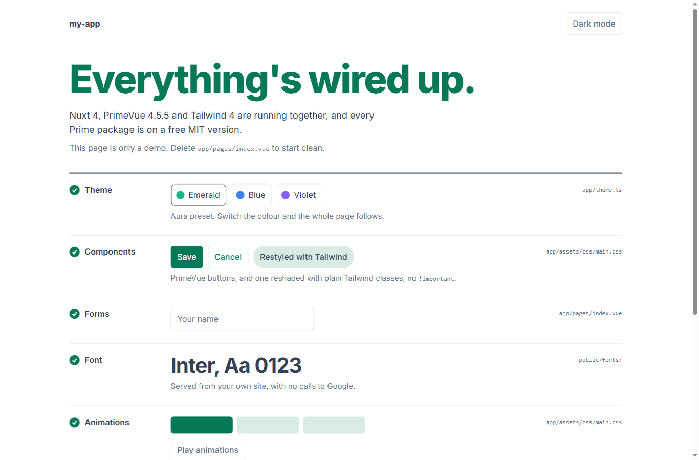

# create-nuxt-primevue

[](https://github.com/kiri1101/create-nuxt-primevue/actions/workflows/ci.yml)
[](https://github.com/kiri1101/create-nuxt-primevue/blob/main/LICENSE)

Start a Nuxt 4, PrimeVue 4 and Tailwind CSS 4 project on the free MIT versions of every Prime package, with a check that fails your build if a non-MIT one ever gets in.

Not affiliated with or endorsed by PrimeTek or the Nuxt team.

Why it exists: `npm install primevue` now installs version 5, which is no longer MIT and shows a red "Invalid PrimeUI License" badge without a licence key. Tutorials that say "install the latest" lead straight to it. [The guide](https://github.com/kiri1101/create-nuxt-primevue/blob/main/docs/traps.md) explains what changed.



## Create a project

```bash
npm create nuxt-primevue@latest my-app
```

This is the same as `npx create-nuxt-primevue my-app`. It asks for the project name if you did not give one, then for the theme, primary colour, font and whether to keep the demo page. It copies the template, installs with the package manager you ran it with (npm, pnpm, Yarn or Bun), runs the licence check, and makes one git commit (unless you pass `--no-git`, or the folder is already inside a repository). Needs Node 22 or later.

To skip the questions, pass flags: see [Flags](#flags).

## What you get

- Nuxt 4, `primevue` 4.5.5, `@primevue/nuxt-module` 4.5.5, `@primeuix/themes` 2.0.3 and `primeicons` 7.0.0, all pinned exactly, with Tailwind CSS 4 and `tailwindcss-primeui`.
- CSS layers ordered so Tailwind utilities override PrimeVue styles without `!important`.
- Dark mode that works in both libraries from one `.dark` class, stored with `@nuxtjs/color-mode`, with no flash on first load.
- The theme in `app/theme.ts`. Light-mode primary colours use shade 700, which keeps white text above a 4.5:1 contrast ratio.
- Inter or Geist, self-hosted from `public/fonts/` with their licence files. No calls to Google.
- Three animations (`animate-fade-up`, `animate-shimmer`, `animate-pulse-soft`) that respect `prefers-reduced-motion`, one example directive and one custom Tailwind `@utility`.
- `scripts/check-licences.mjs`, with no dependencies, run as the first step of the `build` script, so it runs with every package manager (and on its own as `npm run check:licences`).
- A demo page that proves the setup. Delete `app/pages/index.vue` to start clean, or create with `--no-demo`.

## Fix an existing project: `doctor`

Run it from the root of a project that already uses PrimeVue:

```bash
npx create-nuxt-primevue doctor
```

It scans every installed Prime package (`primevue`, `primeicons`, `@primevue/*`, `@primeuix/*`, including nested copies) and reports any whose licence is not exactly `MIT`. It also warns about setup problems, such as a missing CSS layer order or the deprecated `@primevue/themes`.

If it finds non-MIT packages, it asks whether you have a PrimeUI licence key. If you do, it leaves everything alone. If you do not, it proposes moving the direct pins back to the last MIT versions, shows the change, and asks before writing. It only changes a project that is a git repository with a clean working tree, and it never commits. `git checkout .` undoes it.

| Option | Effect |
|---|---|
| `--check` | Scan only. For CI. Exit code 1 if a non-MIT Prime package is found, or if Prime packages are declared but not installed. |
| (exit codes) | 0 fine, 1 a problem remains, 2 the project cannot be scanned (no or invalid `package.json`, or an unknown option). |
| `--yes-fix` | Apply the proposed fix without asking. The clean git tree is still required. |

When the project passes, `doctor` can also offer to add the licence guard script. Nothing from this package is installed in your project: `npx` runs it temporarily.

## The licence situation

From PrimeVue 5.0.0, PrimeTek publishes the library under its commercial PrimeUI licence. That is their decision, and this tool does not work around it. It keeps you on versions that are still MIT, and tells you if you leave them.

As of 2026-11-06:

| Package | `latest` (not MIT) | Last MIT |
|---|---|---|
| `primevue` | 5.0.4 | **4.5.5** |
| `@primevue/nuxt-module` | 5.0.4 | **4.5.5** |
| `@primeuix/themes` | 3.1.0 | **2.0.3** |
| `primeicons` | 8.0.2 | **7.0.0** |

`tailwindcss`, `@tailwindcss/vite`, `tailwindcss-primeui` and `nuxt` are MIT. Staying on v4 means no new v4 features and nothing that exists only in v5. Check PrimeTek's current terms (https://primeui.dev/licenses) for what applies to you; this README may be out of date.

## The guide

[docs/traps.md](https://github.com/kiri1101/create-nuxt-primevue/blob/main/docs/traps.md) covers the licence change in detail and twelve problems in this stack that fail without an error: Tailwind that does nothing, PrimeVue styles that beat your utilities, the red licence badge, half-applied dark mode, fonts that vanish in production and more. Each has the exact error text, the cause and the fix.

## Flags

Skip the questions with flags:

```bash
npx create-nuxt-primevue my-app --theme aura --primary emerald --font inter --yes
```

| Flag | Values | Default |
|---|---|---|
| `--theme` | `aura`, `lara`, `nora`, `material` | `aura` |
| `--primary` | `emerald`, `blue`, `violet`, or a hex colour such as `#1a2b3c` | `emerald` |
| `--font` | `inter`, `geist`, `none` (system font stack) | `inter` |
| `--demo` / `--no-demo` | keep the demo page, or start with an empty page | demo |
| `--git` / `--no-git` | make a git repository and one commit, or skip it | git |
| `--yes`, `-y` | accept the defaults for anything not given, and ask nothing | |

With `--yes` the project name is required. The name must be one new folder, lowercase letters, digits, `-`, `_` and `.`. The CLI refuses a name it cannot use, or a folder that is not empty, before it writes anything.

## Create from the Nuxt CLI instead

If you would rather use the official Nuxt command with this repository as the template:

```bash
npm create nuxt@latest -- -t github:kiri1101/create-nuxt-primevue/template my-app
```

You then get the template as it is: the project name and your choices are not applied. The licence guard is included and runs on `npm run build`. Use the command above for the full flow.

## Development and testing

```bash
npm install
npm run typecheck
npm test              # unit tests
npm run build         # compiles to dist/
npm run test:e2e      # end-to-end checks from a packed tarball (installs and builds real projects; slow)
npm run test:mutation # mutation testing
```

Tests cover only behaviour where a mistake would hurt: the licence check, the `doctor` fix and its git gate, option parsing, and file generation. Expected values come from the spec, not from the code under test. Mutation testing (Stryker) proves those tests catch bugs: it changes the code in small ways and checks that a test fails each time.

In `stryker.config.json`, `tsconfigFile` deliberately points at a file that does not exist, because Stryker's rewrite of the tsconfig crashes on TypeScript 7. The mutation floor is 100, so if a flaky timeout ever fails that job, lowering `thresholds.break` is the documented fallback.

CI runs the unit tests on Ubuntu and Windows, the full end-to-end tests on Ubuntu, one end-to-end case on Windows, and the mutation job.

## Credits and licences

- This project is MIT licensed: see [LICENSE](https://github.com/kiri1101/create-nuxt-primevue/blob/main/LICENSE).
- The fonts Inter and Geist are bundled in generated projects under the SIL Open Font License; the licence files are in `public/fonts/`.
- [PrimeVue](https://primevue.org) is made by PrimeTek. [Nuxt](https://nuxt.com) is made by the Nuxt team. [Tailwind CSS](https://tailwindcss.com) is made by Tailwind Labs. This project is not affiliated with any of them.
